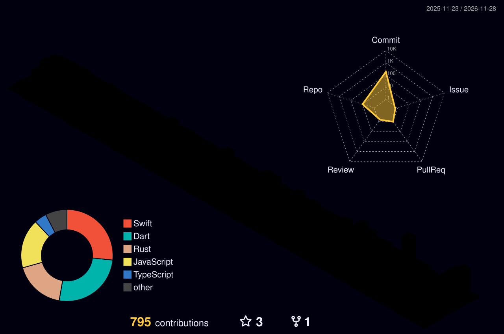

 

---

## 👨‍💻 About Me

- 🎓 Software Engineering student, Department of Informatics at **Institut Teknologi Sepuluh Nopember (ITS)**, class of 2023
- 💼 **Software Engineer** at **Aicareer ID**: Next.js front end, Go backend, Cloud Firestore
- 🧑‍🏫 Former teaching assistant for **Data Structures** and **Databases**
- 🌱 Currently exploring LLM fine-tuning (GRPO) and spatial layout optimization

---

## 🛠️ Tech Stack

---

## 🚀 Featured Projects

| Project | Description | Stack |
| --- | --- | --- |
| 🧤 **Flexi Stroke** | Smart glove and app for post-stroke range-of-motion therapy. PKM gold medalist | ESP32, Flutter, Riverpod, Supabase |
| ♻️ **WANIGO!** | Waste bank digitalization app | Flutter |
| 💰 **Financial Literacy Platform** | Gamified financial learning built with OJK | Next.js |
| 🤖 **GRPO Reward Ablation** | Reward ablation study for fine-tuning Qwen2.5-1.5B | PyTorch, vLLM |

---

## 📊 GitHub Stats

---

## 📈 Contribution Activity

---

<i>"Build things that matter, learn in public."</i> ✨

